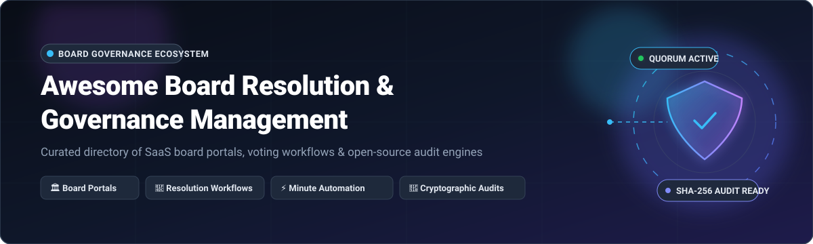

# 🏛️ Awesome Board Resolution & Governance Management

> A curated list of leading SaaS platforms and open-source software for **Board Resolution & Corporate Governance Management**, board portals, resolution workflows, meeting minute automation, and cryptographic governance audit trails.

  
  
  
  
  
  
  
  

---

## 📌 Table of Contents

- [📖 Overview](#-overview)
- [📊 Sector Overview & Market Dynamics](#-sector-overview--market-dynamics)
- [☁️ SaaS/Hosted Platforms](#-saashosted-platforms)
- [💻 Open-Source GitHub Projects](#-open-source-github-projects)
- [🤝 How to Contribute](#-how-to-contribute)
- [💖 Support & Sponsorship](#-support--sponsorship)
- [📈 Star History](#-star-history)
- [⚖️ Disclaimer](#️-disclaimer)

---

## 📖 Overview

This repository tracks premier **SaaS platforms** and **open-source repositories** designed for **Board Resolution & Governance Management**. These systems empower corporate secretaries, general counsels, board chairs, and governance teams to:
- 📝 Compile meeting records and discussions into compliant, audit-ready **legal minutes**.
- 🗳️ Execute secure **board resolutions, consent agendas, and multi-signature voting workflows**.
- 🔐 Maintain tamper-evident, cryptographically verifiable corporate audit trails.
- 🛡️ Safeguard confidential executive communications and sensitive board packs.

---

## 📊 Sector Overview & Market Dynamics

The global board portal and governance management software sector is estimated at **$2.95 billion** (forecasted to reach **$7.93 billion by 2036** at a **10.4% CAGR**). The market is **moderately fragmented at the mid-market and non-profit tiers**, but **highly concentrated at the upper-tier enterprise level**, where category giants Diligent Corporation and OnBoard (Passageways) command approximately 60% combined market share.

---

## ☁️ SaaS/Hosted Platforms

The following table provides detailed pricing, trial terms, company scale (valuation / annual revenue), and key highlights for category-leading SaaS board management providers, sorted by company size (descending):

| Platform | Valuation / Revenue (Scale) | Starting Pricing | Free Tier / Free Trial Limits | Key Focus & Capabilities |
| :--- | :--- | :--- | :--- | :--- |
| **[Nasdaq Boardvantage](https://www.nasdaq.com/solutions/boardvantage)** | **$55.46B Market Cap** (~$5.25B Annual Revenue — Nasdaq, Inc.) | ~$12,000/year (Custom enterprise quote) | **No free tier**; custom self-guided interactive tour / sales demo environment available | Purpose-built for publicly traded companies and financial institutions requiring rigorous regulatory compliance, multi-factor security, and direct integration with the Nasdaq corporate governance suite. |
| **[Diligent Boards](https://www.diligent.com/)** | **~$4.0B+ Valuation** (~$600M+ Annual Revenue) | ~$15,000/year (Custom enterprise quote, avg. ~$25,000/year) | **No free tier**; customized sandboxed demo / sandbox trial available upon sales consultation | Category leader with ~40% enterprise market share. Built on a proprietary, hardened security stack without third-party PDF viewers, offering automated agenda curation, annotations, voting, and AI minute summarization. |
| **[OnBoard (Passageways)](https://www.onboardmeetings.com/)** | **~$105M+ Funding** (~$40M+ Annual Revenue) | Custom enterprise quote (Tiered: Essentials, Premium, Ultimate) | **No free tier**; request-a-demo evaluation access provided by sales team | Intuitive enterprise & mid-market board portal holding ~20% market share. Offers drag-and-drop agenda builders, AI meeting assistants, e-signatures, D&O questionnaires, and multi-board oversight. Acquired BoardEffect in 2023. |
| **[Azeus Convene](https://www.azeusconvene.com/)** | **~$120M Market Cap** (HK$466.8M / ~$60M Annual Revenue — SGX: BBW) | ~$400/user/year (or £195/user/year) | **30-day free trial** with full feature access for unlimited test board members | Internationally accredited board portal with major presence across Europe, APAC, and government bodies. Features live presentation synchronization, multi-language support, and global data centers. |
| **[BoardPAC](https://www.boardpac.com/)** | **Privately Held** (~$26.5M Annual Revenue) | Custom enterprise quote (Annual subscription) | **No free tier**; scheduled personalized sandbox trial available upon request | Enterprise board governance and paperless meeting software with strong enterprise adoption across 40+ countries, multi-platform iPad/Android apps, and strict encryption protocols. |
| **[Govenda](https://govenda.com/)** | **~$6.59M Funding** (~$3.1M Annual Revenue) | Custom quote (Tiered by board seats and organization size) | **No free tier**; guided product evaluation trial available upon request | Cloud-based board portal designed for corporate boards, higher education, and healthcare institutions with relationship intelligence, voting workflows, and committee administration. |
| **[Boardable](https://boardable.com/)** | **~$12.5M Funding** (~$2.0M Annual Revenue) | $20.99/user/month (Essentials plan, billed annually) | **14-day free trial** with full platform capabilities and no credit card required | Transparent, accessible pricing tailored for nonprofits, startups, and SMB boards. Features agenda planning, virtual meeting hosting, polling, and document repositories. |
| **[Aprio](https://www.aprio.com/)** | **Privately Held** (~$1.3M Annual Revenue) | Custom all-inclusive quote (Typically based on a 20-seat baseline allocation) | **30-day to 3-month free trial** with unlimited committees, unlimited administrators, and 24/7 support | All-inclusive pricing model with no hidden per-feature fees, dedicated 24/7 director support, resolution voting, and secure document collaboration. |

---

## 💻 Open-Source GitHub Projects

The following list contains open-source systems, decision engines, and meeting governance tools. Repositories are ranked in descending order by GitHub stargazers count:

- **[Snapshot](https://github.com/snapshot-labs/snapshot-v1)**   
  *Off-chain decentralized governance and proposal voting platform (MIT).*  
  Industry standard for verifiable off-chain voting and resolution management. Supports customizable proposal strategies, quadratic voting, weighted voting, multi-choice ballots, and cryptographic signature validation via EIP-712 without gas fees.

- **[Loomio](https://github.com/loomio/loomio)**   
  *Collaborative decision-making, resolution deliberation, and voting platform (AGPL-3.0).*  
  Designed for boards, cooperatives, and distributed teams to reach consensus asynchronously. Features structured threaded discussions, proposal motions, ranked-choice voting, time polls, approval tracking, and complete decision archives exportable to CSV/JSON.

- **[Decidim](https://github.com/decidim/decidim)**   
  *Participatory governance and democratic assembly framework (AGPL-3.0).*  
  Ruby on Rails-powered platform for institutional governance, strategic assembly deliberation, amendment drafting, public resolutions, and formal voting procedures. Used by municipal governments, universities, and major civic associations globally.

- **[Probo](https://github.com/getprobo/probo)**   
  *Open-source Governance, Risk, and Compliance (GRC) platform (MIT).*  
  Built for high-trust compliance environments with versioned governance documents, approval quorums, electronic signatures, immutable audit logs, policy-based RBAC, and 270+ MCP tools for automated AI governance agents.

- **[Aragon](https://github.com/aragon/client)**   
  *Modular organizational governance and decision execution framework (GPL-3.0).*  
  Enables organizations and committees to manage shared registries, vote on formal resolutions, manage financial authorizations, and execute rule-based governance actions transparently.

- **[OpenSlides](https://github.com/OpenSlides/OpenSlides)**   
  *The digital motion, resolution, and assembly system (MIT).*  
  Complete platform for managing formal assemblies, board conferences, and legislative conventions. Features dynamic agenda management, structured motion/amendment processing, real-time balloting, roll-call voting, speaking lists, and projector views.

- **[Ackify](https://github.com/kOlapsis/ackify)**   
  *Self-hosted cryptographic proof-of-read and compliance acknowledgment system (MIT).*  
  Validates that corporate directors and executives have received, reviewed, and approved sensitive policies and governance resolutions. Uses Ed25519 signatures, document checksum verification (SHA-256/512), and PostgreSQL trigger-based tamper-evident audit logs.

- **[4Minitz](https://github.com/4minitz/4minitz)**   
  *Collaborative meeting minutes, agenda management, and action tracking webapp (MIT).*  
  Specialized tool for taking real-time meeting minutes, tracking decision resolutions, assigning actionable agenda tasks, and generating structured meeting protocols. Can be deployed seamlessly using Docker.

- **[Antragsgrün (Motion.Tools)](https://github.com/CatoTH/antragsgruen)**   
  *Motion and resolution management system for assemblies and conventions (AGPL-3.0).*  
  Engineered for political conventions, NGOs, and assembly boards to manage large volumes of submitted resolutions, line-by-line amendment deliberations, speaking order lists, and recorded roll calls.

- **[Politeia](https://github.com/decred/politeia)**   
  *Cryptographically verifiable governance and proposal system (ISC License).*  
  An innovative, provably secure proposal system storing submissions, amendments, and voting records backed by cryptographic timestamping and verifiable append-only records.

- **[EasyBoard](https://vibecode.law/showcase/easyboard-547268)**   
  *AI-native, self-hosted board management platform built for legal practitioners.*  
  Demonstrates practitioner-designed governance tooling. Automatically classifies incoming documents into 7 governance categories, initiates quorum votes, generates draft minutes with SHA-256 integrity hashes, enforces conflict-of-interest recusals, and maintains a human-in-the-loop secretary approval queue.

- **[GovernanceOS](https://github.com/terra-os/GovernanceOS)**   
  *Open-source global legal entity and subsidiary governance platform (MIT).*  
  Engineered for legal operations and compliance teams across multi-entity corporations. Tracks parent/subsidiary hierarchies, director tenure, quorum thresholds, statutory license expirations, and regulatory board minutes.

- **[Decidiq](https://github.com/ConductionNL/decidiq)**   
  *Universal decision-making and governance application for Nextcloud (EUPL-1.2).*  
  Brings structured motions, meeting minutes, resolution workflows, and decision histories into the Nextcloud ecosystem. Fully WCAG AA compliant with integrated AI Chat Companion tools for governance task execution.

- **[Governance Doc Generator](https://github.com/noamrazbuilds/governance-doc-generator)**   
  *Automated corporate resolution and meeting minutes generator (MIT).*  
  Automates the generation of compliant corporate governance files (board resolutions, written consents, minutes of meetings, officer letters) into clean Word (.docx) documents from standardized form inputs.

---

## 🤝 How to Contribute

1. 🍴 Fork this repository.
2. ➕ Add your project or SaaS tool to the appropriate section, following the existing tabular or badge format.
3. ✅ Ensure pricing, valuation/revenue, and Stars_Badges are accurate and verified.
4. 🚀 Submit a Pull Request with a clear description of the project and why it belongs in this curated collection.

---

## 💖 Support & Sponsorship

Thank you for visiting and using this curated governance ecosystem guide! If you find this resource helpful for your research, legal workflow, or corporate governance stack:

- ⭐ **Star** this repository on GitHub to help others discover it.
- 🍴 **Fork** and contribute additions or improvements.
- 📢 **Share** it with fellow corporate secretaries, legal counsels, and developers.
- ☕ **Buy me a coffee / Sponsor**: If you'd like to support ongoing curation and maintenance, consider sponsoring via the [GitHub Sponsor Dashboard](https://github.com/sponsors/ishandutta2007).

---

## 📈 Star History

---

## ⚖️ Disclaimer

- ℹ️ This is a community-curated directory intended for educational, technical, and procurement research purposes.
- 📜 Board portals and electronic minutes solutions handling confidential corporate records must adhere to applicable corporate governance laws, securities regulations, and data sovereignty standards.
- 🛡️ Inclusion does not constitute a formal legal or regulatory endorsement.
